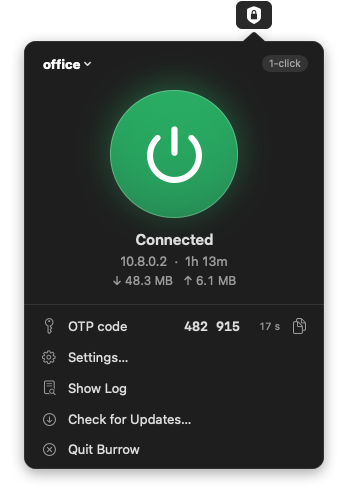
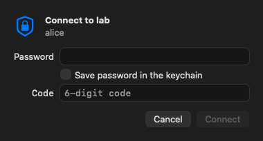
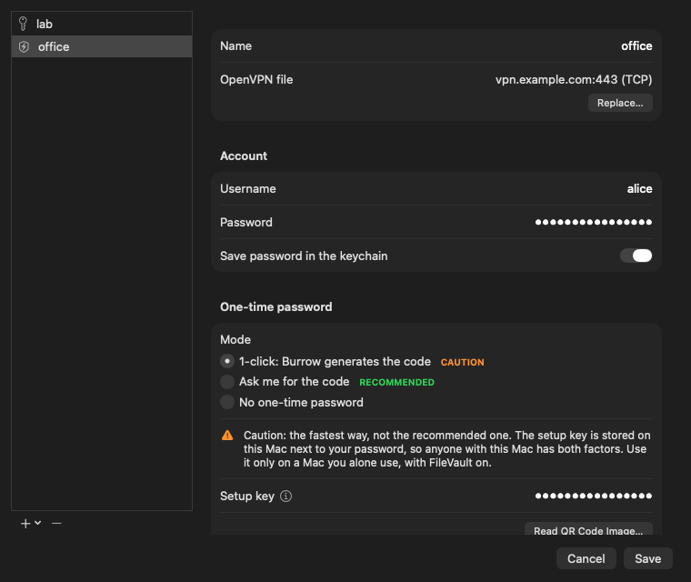
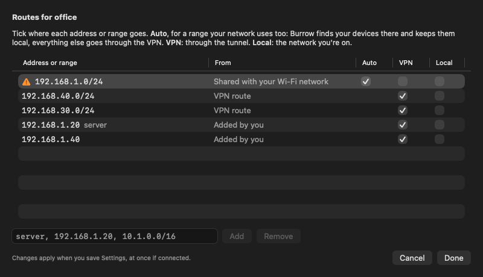

# Burrow

A menu-bar OpenVPN client for macOS that can type the one-time password for you. OpenVPN 3 runs inside Burrow's
own network extension: no Tunnelblick, no root helper.

<p>
  
  
</p>



- One click to connect, with the code generated from your authenticator's setup key, or asked each time
- Password, certificate, encrypted key, challenges, web sign-in (SSO), PKCS#12 and proxy logins
- Works when your network uses the same addresses as the VPN: your devices stay local, the rest goes through
- Imports Tunnelblick configurations and `.ovpn` files; passwords and keys go in the keychain
- Notarized, updates itself (Sparkle)



## Install

Download `Burrow-<version>.dmg` from the [latest release](https://github.com/Cirtadev/burrow/releases/latest), open
it and drag Burrow to Applications (macOS 15 or later). On first launch, allow its network extension in
System Settings › General › Login Items & Extensions.

## Build

Needs Xcode 27 and XcodeGen (`brew install xcodegen`).

```bash
./scripts/build-app.sh --install   # builds and installs to /Applications
cd BurrowKit && swift test         # unit tests
```

## More

- [User guide](docs/GUIDE.md): setup, sign-in methods, routing, security notes, development
- [Releasing](docs/RELEASING.md): signing, notarization, publishing, AGPL source

© 2026 Cirtadev GmbH ([cirtadev.com](https://cirtadev.com)). AGPL-3.0 ([LICENSE](LICENSE)). Not affiliated with
Tunnelblick or OpenVPN Inc.
