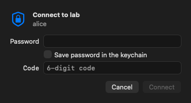
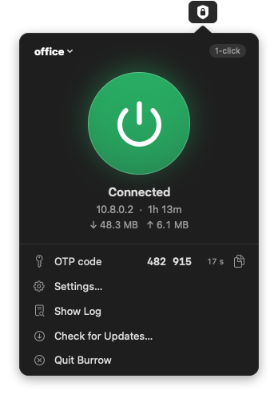
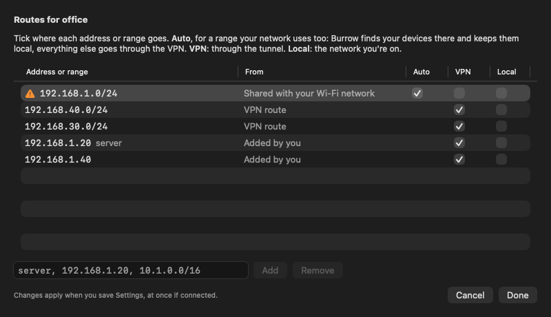

# Burrow user guide

[Back to the README](../README.md)

- [Install](#install)
- [Configurations](#configurations)
- [Using it](#using-it)
- [How sign-in works](#how-sign-in-works)
- [Routing](#routing)
- [Security notes](#security-notes)
- [Development](#development)
- [Layout](#layout)

## Install

Burrow is distributed outside the Mac App Store as a notarized, Developer ID-signed disk image (it can't be in the
store: OpenVPN 3 is AGPL). It needs macOS 15 or later.

1. Download `Burrow-<version>.dmg` from the [latest release](https://github.com/Cirtadev/burrow/releases/latest),
   open it and drag **Burrow** onto **Applications**. Burrow only works from the Applications folder: started
   anywhere else (from the disk image, Downloads) its panel says *Move Burrow to the Applications folder and open it
   from there*.
2. Open Burrow from Applications. macOS asks *"Burrow" is an app downloaded from the internet. Are you sure you
   want to open it?*: click **Open**.
3. Burrow installs its VPN tunnel, a network system extension. macOS shows *System Extension Blocked* (or
   *"Burrow" would like to add a network extension*): click **Open System Settings**, then in
   **General › Login Items & Extensions › Network Extensions** turn on **Burrow** and confirm with your password or
   Touch ID. Until then the panel says *Allow Burrow's VPN in System Settings › …*; clicking connect again opens the
   right pane.
4. Burrow asks to send notifications (reconnects, "enter a new code").
5. The first connect asks *"Burrow" Would Like to Add VPN Configurations*: click **Allow**. Burrow then appears in
   System Settings › VPN.
6. On its second launch Burrow asks whether to check for updates automatically.

**Updates**: *Check for Updates…* in the panel or the right-click menu (or automatic checks). Sparkle downloads the
new disk image, checks its EdDSA signature and Developer ID signature, replaces Burrow in Applications and relaunches
it; the new tunnel extension replaces the old one without asking again. Quitting Burrow disconnects, so an update
interrupts the VPN briefly.

**Uninstall**: delete the configurations in Settings (that removes their keychain items), quit Burrow and drag it
to the Trash; macOS asks to remove its network extension as well. Remove *Burrow – …* in System Settings › VPN if it
is still listed.

## Configurations

First launch opens Settings. Add configurations with **+**:

- **Import from Tunnelblick…** reads every Tunnelblick configuration: the config itself (shared ones are root-only, so
  macOS asks for an administrator password once), the saved username and password (macOS asks to allow access to
  Tunnelblick's keychain items), and whether Tunnelblick asked for a security token. Referenced certificate/key
  files are inlined.
- **Import .ovpn File…** takes a config from the VPN portal. Certificates and keys it names (`ca ca.crt`) are
  inlined from the same folder, since the tunnel extension can't read files. Logins it carries (`<auth-user-pass>`,
  `auth-user-pass login.txt`, `askpass`, proxy logins) move into the keychain, and a PKCS#12 certificate
  (`pkcs12 me.p12` or `<pkcs12>`) is converted to `<cert>`/`<key>` with macOS's `openssl` after asking for its
  password. New configurations start in *Ask me for the code* mode.

Each configuration has:

- **Account**: username and password for configs with `auth-user-pass`; a config without it signs in with its
  certificate only. An encrypted `<key>` adds a **Key passphrase** field.
- **Save password in the keychain** (and the passphrase): off means the sign-in window asks each time.
- **One-time password mode**:
  - *1-click: Burrow generates the code* (marked **Caution**) from the stored Base32 secret / `otpauth://` link.
    The fastest, not the recommended way: the setup key lives on the Mac next to the password, so the Mac alone
    is enough to sign in. The live preview must match your authenticator app.
  - *Ask me for the code* (**Recommended**): the sign-in window takes the code from your phone.
  - *No one-time password*: username and password only (or the certificate).
- **Send the code**: *with the password* (e.g. `mypassword123456` for the password `mypassword` and the code `123456`, what most servers expect) or *when the server asks for
  it* (a dynamic challenge or CR_TEXT after the password). A config with `static-challenge` always gets the code in
  its own field.

Disconnect and quit Tunnelblick before connecting: two tunnels with the same routes conflict.



## Using it

- **Click** the shield for the panel: the configuration (pick another from its name), a big power button that
  connects or disconnects (grey = off, pulsing blue = connecting, green = connected, orange = failed; a 1-click
  configuration connects at once, the others show the sign-in window), status, tunnel address, uptime and
  traffic, the current OTP code (click to copy), *Settings…*, *Show Log*, *Check for Updates…* and *Quit*.
  **Right-click** (or Control/Option-click) gives the same as a compact menu.



- Icon: outline shield = off, half-filled blinking = connecting, filled lock shield = connected,
  exclamation shield = failed (the menu says why).
- General settings: *Start Burrow at login*, *Connect when Burrow starts*, *Reconnect after drops and sleep*,
  *Show notifications*, *Send all DNS lookups through the VPN* (off by default: the Mac keeps its own DNS servers).
- Reconnecting: a 1-click configuration recovers on its own with a fresh code (after sleep, network changes,
  server restarts or a drop, backing off 5 s → 2 min) and posts a "Reconnected" notification. A configuration that
  asks for the code posts "Enter a new code to reconnect" and opens the sign-in window.
- Quitting Burrow disconnects, like Tunnelblick.

## How sign-in works

Burrow hands the configuration to the tunnel extension with each connect (see [Security notes](#security-notes)).
It supports what OpenVPN 3 clients support:

| Method | How Burrow handles it |
|---|---|
| Username + password (`auth-user-pass`) | saved in the keychain, or asked in the sign-in window |
| Certificate only (no `auth-user-pass`) | nothing to ask |
| Encrypted private key | passphrase saved or asked; a rejected saved one is forgotten and asked again |
| Password + OTP appended | the code right after the password (e.g. `mypassword123456`), generated (1-click) or typed |
| Static challenge (`static-challenge "text" 1`) | the code or answer goes in its own field (SCRV1) |
| Dynamic challenge (`CRV1`, e.g. privacyIDEA, RADIUS SMS/PIN) | 1-click answers with a fresh code; otherwise the server's question pops up |
| `CR_TEXT` (OpenVPN 2.6 auth-pending) | same; the answer goes back as `CR_RESPONSE` |
| Web sign-in / SSO (`OPEN_URL`, `WEB_AUTH`, e.g. Access Server SAML, CloudConnexa, openvpn-auth-oauth2) | Burrow announces `IV_SSO=openurl,webauth,crtext`, opens the page in your browser and waits; *Open Sign-in Page* in the panel reopens it |
| Static challenge, `concat` format (OpenVPN 2.6) | the code is appended to the password |
| PKCS#12 certificate (`.p12`) | converted at import |
| Credentials in the file or a file next to it | moved into the keychain at import |
| HTTP proxy login (`http-proxy`) | proxy username and password in Settings |
| Session tokens (`auth-token`) | reconnects use the token instead of a new code |

Not supported: certificates kept in the macOS keychain or on a smart card / YubiKey (PKCS#11), and static-key
(`secret`) configs, which OpenVPN 3 dropped. A server's sign-in page link must be `https://` or `http://`;
anything else is ignored.

With a one-time password, every sign-in gets a fresh code:

- password + current 6-digit code, no separator, as Tunnelblick's "security token" field did;
- a time step is never sent twice; with less than 3 s left Burrow waits for the next code (the panel counts down);
- OpenVPN normally resends cached credentials when it reconnects (network change, wake, server restart), and the
  old code would be rejected. Burrow instead restarts the session with a new code, keeping the tunnel up;
- if the server rejects a code, Burrow tries once more with the next one, then stops and says so, so a wrong
  password can't lock the account.

## Routing

When the network you're on uses the same addresses as the VPN (both `192.168.1.x`), macOS would send them all to
the local network, and the company servers there would be unreachable. Burrow splits the range by itself: once
connected it looks for the devices on your network (a small UDP packet to each address of the shared range once a
second, bound to the Wi-Fi or Ethernet interface; macOS reports the addresses nobody answers for as down), keeps
those local, and routes every other address of the range through the VPN as more specific routes. It looks again
every 10 minutes and after a network change, and only for shared ranges up to a /22. macOS asks once to allow
Burrow on the local network (Privacy & Security › Local Network); without that, Burrow can't see the devices and
says so in the panel.

*Choose Routes…* opens a table of the VPN's routes (remembered from the last connection), the shared ranges and your
own entries, with **Auto** (shared ranges only), **VPN** and **Local** boxes. Addresses show their `/etc/hosts`
name (`192.168.1.20 server`), and you can add a server by name: Burrow stores the addresses it resolves to. VPN
entries win over the local network; Local entries become excluded routes. Changes apply at once to a running tunnel.



## Security notes

- Each configuration (config with its private key, username, password if saved, OTP secret) is one item in
  Burrow's data-protection keychain group (`keychain-access-groups`).
- The tunnel is a system extension that macOS runs as root in its own sandbox; it can't read the user's keychain.
  On every connect Burrow reads the configuration and passes what the tunnel needs in the start options
  (`startVPNTunnel(options:)`): the `.ovpn` text, username, password, OTP mode and either the OTP secret (1-click)
  or the typed code. The extension keeps them in memory for reconnects and drops them when the tunnel stops; it
  never writes them to disk or logs them. A password or code typed in the sign-in window is not stored unless
  *Save password* is on.
- Connecting from System Settings › VPN or the menu-bar VPN menu starts the tunnel without those options: it stops
  at once with *Open Burrow to connect*, and a running Burrow then connects the configuration itself.
- Keeping the OTP secret next to the password turns two factors into one: anyone with the unlocked Mac can
  connect. Check that this fits the VPN owner's policy.
- The tunnel runs OpenVPN 3 Core 3.11.8 with Mbed TLS 3.6.7 LTS (TLS 1.2 and 1.3), vendored in
  `ThirdParty/OpenVPNAdapter` ([what Burrow changed](../ThirdParty/OpenVPNAdapter/BURROW-CHANGES.md)). Mbed TLS 3.6
  is maintained until March 2027; OpenVPN 3 doesn't support Mbed TLS 4 yet.

## Development

Needs Xcode 27 or later, XcodeGen (`brew install xcodegen`) and an Apple ID of the Cirtadev GmbH team signed in to
Xcode (Settings › Accounts). The Network Extension and System Extension entitlements only work with a provisioning
profile, so these targets can't be ad-hoc signed. Development builds are signed with an Apple Development
certificate; [releases](RELEASING.md) with Developer ID.

```bash
./scripts/build-app.sh             # xcodegen + xcodebuild → build/Burrow.app, build/burrowctl
./scripts/build-app.sh --install   # the same, then copies it to /Applications/Burrow.app and opens it there
```

The tunnel is a system extension (`Contents/Library/SystemExtensions/dev.cirta.burrow.tunnel.systemextension`), and
macOS only installs one from an app in /Applications, so connect with the `--install` copy (or run
`systemextensionsctl developer on`, which needs SIP turned off, to allow any location). Every development build gets
its own build number (`<CURRENT_PROJECT_VERSION>.<date>.<time>`), because macOS only replaces an active extension
whose version changed. Both scripts refuse to replace the app while Burrow's VPN is connected.

The first build compiles OpenVPN 3 and mbedTLS (about 8 minutes) and lets Xcode register the app IDs
`dev.cirta.burrow` and `dev.cirta.burrow.tunnel` (Network Extension and System Extension capabilities) and the Mac.

```bash
cd BurrowKit && swift test                         # TOTP, scheduler, .ovpn reader, routing, protocol tests
build/burrowctl otp <secret>                       # print the current code
build/burrowctl ovpn ~/Downloads/<file>.ovpn       # summarize a config (never prints keys)
scripts/screenshots.sh                             # render the screenshots with sample data
systemextensionsctl list                           # is the tunnel extension active?
/usr/bin/log stream --info --predicate 'subsystem == "dev.cirta.burrow.tunnel"'   # tunnel log
```

## Layout

- `App/`: the menu-bar app (AppKit status item, SwiftUI settings and sign-in window, notifications,
  Tunnelblick importer, `NETunnelProviderManager` control, system extension activation, Sparkle updater).
- `Tunnel/`: the system extension: `main.swift`, `PacketTunnelProvider`, OpenVPN 3 via OpenVPNAdapter, OTP sign-in
  and restarts.
- `BurrowKit/`: Swift package with TOTP, the OTP scheduler, the multi-profile store, the `.ovpn` reader and
  importer, routing, the local network scan, the Tunnelblick config inliner and `burrowctl`; also the Tunnelblick
  daemon and management clients from the first version.
- `ThirdParty/OpenVPNAdapter/`: OpenVPNAdapter (upstream 33afba0) with OpenVPN 3 Core 3.6.1, plus a
  control-channel send for CR_TEXT answers (`BURROW-CHANGES.md`).
- `project.yml`: XcodeGen spec (the `.xcodeproj` is generated and not committed), versions, the update feed URL
  and Sparkle's public key.
- `scripts/`: `build-app.sh` (development), `release.sh`, `notarize.sh`, `notarize-collect.sh`, `publish.sh`
  ([Releasing](RELEASING.md)).
- `release/appcast.xml`: the Sparkle feed.
- `docs/`: this guide, [Releasing](RELEASING.md), [how Tunnelblick's login works](tunnelblick-protocol.md),
  screenshots.
- `legacy/tunnelblick-app/`: the first version, which drove Tunnelblick's installed root helper (not built).
- `LICENSE`: GNU AGPL v3.
